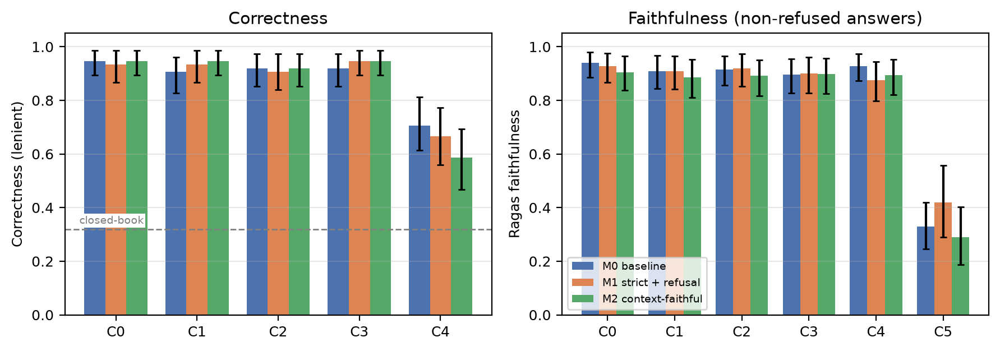

# Auditing Faithfulness and Hallucinations in RAG Systems

Authors: Bikesh Regmi, MD Rahman, and Kofi Nyarko

This README explains what this project does, how it works step by step, where every result is stored, and how to run it yourself. It is written so that someone without an AI background can follow it.

---

## Table of contents

1. [The idea in plain language](#1-the-idea-in-plain-language)
2. [Key terms](#2-key-terms)
3. [What the experiment tests](#3-what-the-experiment-tests)
4. [How the pipeline works](#4-how-the-pipeline-works)
5. [Where everything is (folder guide)](#5-where-everything-is-folder-guide)
6. [How to run it](#6-how-to-run-it)
7. [How to read the outputs](#7-how-to-read-the-outputs)
8. [Current status and results](#8-current-status-and-results)
9. [Tools and models used](#9-tools-and-models-used)
10. [Known limitations](#10-known-limitations)
11. [Troubleshooting](#11-troubleshooting)

---

## 1. The idea in plain language

Chatbots like ChatGPT sometimes make things up. A popular fix is **RAG (Retrieval-Augmented Generation)**: before the AI answers, the system looks up relevant documents and hands them to the AI, saying "answer using these."

The hope is that the AI then sticks to the documents. **This project checks whether that hope holds up**, especially when the documents handed to the AI are imperfect. That includes documents that are off-topic, noisy, contradictory, or simply missing the answer.

The approach works like a driving test:

1. Take a set of questions whose correct answers are already known.
2. Give the AI documents, sometimes good ones and sometimes deliberately bad ones.
3. Try a few different instructions ("prompts") to see which ones make the AI behave better.
4. Grade every answer: Did it stick to the documents? Was it correct? Did it admit when it didn't know?

Everything runs **locally on a Mac**. No data is sent to any online AI service.

---

## 2. Key terms

| Term | Meaning |
|---|---|
| **LLM** | Large Language Model: the AI that writes answers (here, `qwen3:8b`). |
| **RAG** | Retrieval-Augmented Generation: look up documents first, then let the LLM answer using them. |
| **Passage / context** | The pieces of text handed to the LLM along with the question. |
| **Gold passage** | The passage that actually contains the correct answer. |
| **Gold answer** | The known correct answer (written by humans in the dataset). |
| **Hallucination** | An answer that is made up or not supported by the given passages. |
| **Faithfulness / groundedness** | Whether the answer is supported by the passages given, regardless of whether those passages are true. |
| **Correctness** | Whether the answer matches the real gold answer. |
| **Refusal** | The model says "I don't know" instead of answering. This is good when the answer isn't in the passages and bad when it is. |
| **Judge model** | A second, larger AI (`qwen3.8:27b`) that grades the first AI's answers. |
| **Embedding** | A list of numbers representing the meaning of a text, used to find similar passages. |
| **Perturbation** | Deliberately changing the passages (adding noise, contradictions, and so on) to stress-test the AI. |
| **Mitigation** | A change to the instructions meant to reduce hallucination. |

---

## 3. What the experiment tests

### Research questions

- **RQ1:** How do faithfulness and relevance scores change as the passages get worse?
- **RQ2:** Do some kinds of bad passages hurt more than others? Does "faithful to the passage" agree with "actually correct"?
- **RQ3:** Which instructions improve faithfulness, and how often do they make the model wrongly refuse questions it could have answered?

### The data: SQuAD v2.0

[SQuAD v2.0](https://rajpurkar.github.io/SQuAD-explorer/) is a well-known Stanford dataset of questions about Wikipedia paragraphs, with human-written answers. About half its questions are deliberately **unanswerable** from their paragraph, which makes it a good fit for testing whether the AI admits "I don't know."

From the official validation file, this project uses:
- **25 Wikipedia articles**, which give **861 passages** (the "library" the system searches).
- **95 questions**: **75 answerable** and **20 unanswerable**.

### The 6 test conditions (how passages are changed)

Every answerable question is tested under all six conditions. Each row shows what the AI receives.

| Code | Name | What the AI receives | What it tests |
|---|---|---|---|
| **C0** | Clean | Only the gold passage | The best case (control) |
| **C1** | Random distractors | Gold passage + 3 passages from unrelated articles | Can it ignore obviously off-topic text? |
| **C2** | Related distractors | Gold passage + 3 on-topic passages that **don't** contain the answer | Can it ignore text that looks relevant but isn't? |
| **C3** | Noisy | Gold passage + 3 related + 3 random passages (7 total) | Heavy noise |
| **C4** | Contradictory | Gold passage + a **fake copy** with the answer swapped (e.g. "1895" → "1865") + 2 related passages | Which version does it believe? |
| **C5** | Unanswerable | 4 related passages, **gold passage removed** | Does it admit it doesn't know, or make something up? |

The 20 unanswerable SQuAD questions only get C5, using their original paragraph (which doesn't contain the answer) plus 3 related passages.

**Position control:** the order of passages is shuffled (with a fixed random seed) and the position of the gold or fake passage is recorded. Research shows LLMs pay less attention to text in the middle of a long input ("lost in the middle"), so position needs to be tracked.

### The 3 instruction styles (mitigations)

The exact text of each prompt is in the `prompts/` folder.

| Code | Name | What the instruction says |
|---|---|---|
| **M0** | Baseline | "Use the following context to answer the question." |
| **M1** | Strict + refusal | "Answer ONLY from the context. If the answer isn't there, reply exactly: I don't know." |
| **M2** | Context-faithful | Reframes the passages as "Bob said: ..." and asks for the answer "in Bob's opinion," with two example Q&As where Bob says something false. This trains the AI to follow the text rather than its own memory (Zhou et al., 2023). It also includes the "I don't know" rule. |

There is also a **closed-book** run: the AI answers each question **with no passages at all**. If the AI gets an answer right without passages, it may have memorized it, which matters when interpreting the other results.

### What gets measured for every answer

| Measure | How | Meaning |
|---|---|---|
| **Faithfulness** | Judge model (Ragas) | Share of the answer's claims that are supported by the passages (0–1). Not computed for refusals. |
| **Answer relevance** | Judge model (Ragas) | Does the answer address the question? (0–1). Reported only for answers that are not refusals, because "I don't know" always scores low here even when it is the right answer. |
| **Context precision** | Judge model (yes/no per passage) | Share of the passages given to the AI that actually help answer the question (0–1). Measures how noisy the passages are. |
| **Correctness** | Text matching | Does the answer match the gold answer? Lenient: all numbers plus at least 2/3 of the words must appear, so "defensins" counts for "β-defensins". A strict exact-match version is also recorded. |
| **Refusal** | Text matching | Did the AI say "I don't know" or similar? |
| **Followed the fake** (C4 only) | Text matching | Did the AI repeat the swapped (false) answer? |

**Why context precision instead of Ragas "context relevance":** in the pilot, Ragas context relevance gave **1.0 to every context** in C0–C4, even with 6 distractors in C3, because it only asks whether *some* passage is relevant. It could not show retrieval getting worse. The judge now rates each passage separately, which does show it. Pilot values: C0 1.00, C1 0.25, C2 0.44, C3 0.25, C4 0.66, C5 0.22.

**The "Bob" fix:** M2 answers start with "In Bob's opinion, …". The passages never mention Bob, so the judge marked these correct answers as unfaithful (0.0). The "Bob" phrasing is removed before grading. This changes all M2 answers and no others, and the exact text the judge saw is saved as `judged_response`.

---

## 4. How the pipeline works

The work is split into small steps. Each step reads the previous step's output from disk, so any step can be rerun on its own.

```
 SQuAD CSV
    │
    ▼
 [1] Build dataset ──► passages.jsonl + questions.jsonl
    │
    ▼
 [2] Build search index ──► Chroma database (embeddings of all 861 passages)
    │
    ▼
 [3] Build test contexts ──► contexts.jsonl (C0–C5 for every question)
    │
    ▼
 [4] Generate answers (qwen3:8b) ──► runs/<run>/generations.jsonl (+ a snapshot of contexts.jsonl)
    │
    ▼
 [5] Grade answers (qwen3.8:27b judge) ──► runs/<run>/judge_passages.jsonl + judge_answers.jsonl
    │
    ▼
 [6] Summarize (adds text checks) ──► runs/<run>/scored.csv + results/<run>/summary.md
```

### Step 1: Build the dataset (`src/ingest/build_dataset.py`)
- Reads `data/raw/squad_v2/validation.csv`.
- Fixes the unusual `answers` column, which is stored as Python text rather than JSON. All 11,873 answers were checked to line up exactly with their passages.
- Picks 25 articles at random (seed 42, so the same 25 every time).
- Selects 75 answerable questions (at most one per passage, with short answers of 5 words or fewer for reliable scoring) and 20 unanswerable ones.

### Step 2: Build the search index (`src/retrieve/index.py`)
- Converts every passage into an embedding using `nomic-embed-text`.
- Stores the embeddings in a **Chroma** database so similar passages can be found quickly.
- The search engine finds the gold passage in its top 4 results for **95% (71/75)** of answerable questions.

### Step 3: Build the test contexts (`src/perturb/build_contexts.py`)
- For each question, uses the search index to find related passages and picks random ones from other articles.
- Builds the six conditions C0–C5 described above.
- Distractor passages (related and random) never contain the answer, not even partly (e.g. a passage mentioning "defensins" is excluded for the answer "β-defensins"). This keeps C5 truly "answer missing."
- For C4, creates the fake passage by swapping the answer for a believable wrong one:
  - Numbers get different digits; years shift by 5–40 years and decades by 10–30 years ("1950s" → "1970s").
  - **55 of the 75 fake answers were reviewed by hand** and replaced with plausible ones of the same kind (e.g. "Robert Boyle" → "Henry Cavendish", "Spanish" → "Portuguese"). They are stored in `data/perturbations/substitute_overrides.json`, and the script checks that none of them already appears in its passage or resembles the real answer.

### Step 4: Generate answers (`src/generate/run_generation.py`)
- Sends every (question, condition, instruction style) combination to `qwen3:8b` through Ollama.
- Temperature 0 and a fixed seed, so answers are repeatable. "Thinking mode" is turned off, so answers are short and direct.
- Saves every answer immediately. If the script is stopped, rerunning it **continues where it left off**.
- Saves a copy of `contexts.jsonl` into the run folder, so rebuilding the contexts later never changes a finished run.
- Writes a `manifest_generation.json` recording exact versions of models and libraries, for reproducibility.

### Step 5: Grade answers (`src/evaluate/run_judge.py`)
- **Phase 1:** the judge answers yes/no for whether each passage helps answer its question. Each (question, passage) pair is judged once and reused across conditions (~3 s each).
- **Phase 2:** the judge scores faithfulness and answer relevance for every answer using **Ragas** (~40 s per answer).
- Resumes where it left off if stopped.

### Step 6: Summarize (`src/analysis/summarize.py`)
- Adds the text checks (correctness, refusal, followed the fake).
- Writes `runs/<run>/scored.csv` (one row per answer, every field; opens in LibreOffice) and `results/<run>/summary.md` (averages by condition and instruction style).

### Step 7: Statistics and charts (`src/analysis/stats.py`)
- **Confidence intervals:** how much each average could change with a different set of questions (95% bootstrap, resampling questions).
- **Paired tests:** each question was asked under every condition and instruction style, so two settings are compared question by question. Yes/no outcomes (correct, refused, followed the fake) use McNemar's test; faithfulness scores use the Wilcoxon test. p-values are corrected for running many tests at once (Holm).
- Extra breakdowns: what the AI answered in C4 (real answer, fake answer, both, neither), faithful vs. correct, where the real passage was placed, and whether knowing the answer from memory protects against the fake.
- Writes `results/<run>/stats.md`, CSV tables and four charts in `results/<run>/figures/`.

### Step 8: Human check of the judge (`src/analysis/human_validation.py`)
- `sample` picks 80 answers (judge scores hidden) for a person to grade by hand; see `labels/INSTRUCTIONS.md`.
- `agree` compares the person's grades with the judge and the text checks (Cohen's kappa, accuracy, Spearman correlation) and writes `results/<run>/human_validation.md`.

---

## 5. Where everything is (folder guide)

```
rag-faithfulness-audit/
├── README.md                     ← you are here
├── pyproject.toml / uv.lock      ← Python package list with exact versions
├── .env.example                  ← template for API keys (not currently needed)
│
├── docs/
│   └── environment.md                    ← machine, model, and library versions
│
├── configs/
│   ├── pilot.toml                ← settings for the pilot (10 questions)
│   └── full.toml                 ← settings for the full run (95 questions)
│
├── prompts/                      ← the exact instructions given to the AI
│   ├── M0_baseline.txt
│   ├── M1_strict_refusal.txt
│   ├── M2_context_faithful.txt
│   └── closed_book.txt
│
├── data/
│   ├── raw/squad_v2/             ← original downloaded dataset (never edited; not in git)
│   ├── corpus/passages.jsonl     ← the 861 passages
│   ├── questions/questions.jsonl ← the 95 questions with gold answers
│   ├── perturbations/contexts.jsonl ← the passages given to the AI for each condition
│   ├── perturbations/substitute_overrides.json ← hand-reviewed fake answers for C4
│   └── index/chroma_db/          ← search index (not in git)
│
├── src/                          ← the code, one folder per step
│   ├── common.py                 ← shared helpers
│   ├── manifest.py               ← records versions for each run
│   ├── ingest/build_dataset.py   ← step 1
│   ├── retrieve/index.py         ← step 2
│   ├── perturb/build_contexts.py ← step 3
│   ├── generate/run_generation.py ← step 4
│   ├── evaluate/rules.py         ← text checks (correctness, refusal, Bob fix)
│   ├── evaluate/run_judge.py     ← step 5
│   ├── analysis/summarize.py     ← step 6
│   ├── analysis/stats.py         ← step 7 (statistics and charts)
│   └── analysis/human_validation.py ← step 8 (human check of the judge)
│
├── runs/<run_name>/              ← raw outputs of a run, e.g. runs/pilot, runs/full (not in git)
│   ├── contexts.jsonl            ← snapshot of the passages used in this run
│   ├── generations.jsonl         ← every answer the AI gave
│   ├── judge_passages.jsonl      ← judge's yes/no relevance for each passage
│   ├── judge_answers.jsonl       ← judge's faithfulness / answer relevance for each answer
│   ├── scored.csv                ← everything combined, one row per answer
│   ├── *.log                     ← progress logs
│   └── manifest_*.json           ← exact versions used
│
├── results/<run_name>/
│   ├── summary.md                ← averages per condition and instruction style
│   ├── stats.md                  ← confidence intervals, significance tests, breakdowns
│   ├── figures/                  ← charts (PDF and PNG)
│   └── human_validation.md       ← judge vs. human agreement (after labeling)
└── labels/                       ← human grading sheet (validation_sheet.csv) and instructions
```

**About `.jsonl` files:** each line is one record in JSON format. They can be opened in Cursor or any text editor. In Python, `pandas.read_json(path, lines=True)` loads one as a table.

---

## 6. How to run it

### One-time setup (already done on this Mac)

1. Install [Ollama](https://ollama.com) and download the models:
   ```bash
   ollama pull qwen3:8b
   ollama pull nomic-embed-text
   ollama pull qwen3.8:27b      # judge model
   ```
2. Install [uv](https://docs.astral.sh/uv/), then, from the project folder:
   ```bash
   uv sync
   ```
   This creates the `.venv` environment with the exact package versions from `uv.lock`.
3. Download SQuAD v2.0 and place `validation.csv` in `data/raw/squad_v2/`.

### Running the pipeline

Open a terminal in the project folder and run each step in order. The `--config` option chooses the settings file.

```bash
# Step 1: build passages and questions (about 1 second)
uv run python -m src.ingest.build_dataset --config configs/pilot.toml

# Step 2: build the search index (about 15 seconds)
uv run python -m src.retrieve.index --config configs/pilot.toml

# Step 3: build the C0–C5 test contexts (about 5 seconds)
uv run python -m src.perturb.build_contexts --config configs/pilot.toml

# Step 4: generate answers (pilot: 158 answers, ~7 minutes; full: 1,485 answers, ~1 hour)
uv run python -m src.generate.run_generation --config configs/pilot.toml

# Step 5: grade answers (pilot: ~2 hours; full: ~15 hours)
uv run python -m src.evaluate.run_judge --config configs/pilot.toml

# Step 6: build scored.csv and the summary tables (seconds; can be run any time)
uv run python -m src.analysis.summarize --config configs/pilot.toml

# Step 7: statistics and charts (about 20 seconds; needs step 6)
uv run python -m src.analysis.stats --config configs/full.toml

# Step 8: human check of the judge
uv run python -m src.analysis.human_validation sample --config configs/full.toml   # make the sheet (already done)
# ... fill in labels/validation_sheet.csv by hand ...
uv run python -m src.analysis.human_validation agree --config configs/full.toml    # compare with the judge
uv run python -m src.analysis.human_validation agree --config configs/full.toml --sheet labels/validation_sheet_annotator2.csv   # second labeler vs judge
uv run python -m src.analysis.human_validation iaa --config configs/full.toml      # labeler 1 vs labeler 2
```

Replace `configs/pilot.toml` with `configs/full.toml` for the full run. Steps 1–3 only need to be run again if their settings change. Steps 4 and 5 skip work that is already done. To start a run from scratch, delete its `runs/<run_name>/` folder.

**Running the full run in tmux** (keeps going after you close the terminal; `caffeinate` stops the Mac from sleeping):

```bash
tmux new -s rag
caffeinate -i sh -c 'uv run python -u -m src.generate.run_generation --config configs/full.toml && uv run python -u -m src.evaluate.run_judge --config configs/full.toml && uv run python -m src.analysis.summarize --config configs/full.toml' 2>&1 | grep --line-buffered -v -i warn | tee -a runs/full.log
```

Detach with `Ctrl+B` then `D`; reattach with `tmux attach -t rag`. Keep the Mac plugged in with the lid open.

### Running any model, and other judges (`src/run_model.py`)

One command runs generation → judging → summary for **any Ollama model**. Everything except the model comes from `configs/full.toml`, and every run reuses the frozen `runs/full/contexts.jsonl`, so all models see exactly the same passages, prompts, temperature, and seed. The model is downloaded automatically if needed. Like the other steps, it can be stopped and restarted without losing work.

```bash
# A new answer model, graded by the local Qwen 27B judge -> runs/full_llama3.1-8b, results/full_llama3.1-8b
uv run python -u -m src.run_model --model llama3.1:8b

# Only generate (fast; correctness, refusal, and fake-following need no judge), judge later
uv run python -u -m src.run_model --model mistral:7b --steps gen,summarize
uv run python -u -m src.run_model --model mistral:7b --steps judge,summarize

# Second-opinion judges on the original Qwen3-8B run, only the human-labeled answers and all C4 answers
uv run python -u -m src.run_model --model qwen3:8b --judge gemini,haiku --subset human,c4 --steps judge,summarize

# Quick test (2 questions, judge only 3 items) in a throwaway folder
uv run python -u -m src.run_model --model llama3.1:8b --name smoke_llama --questions 2 --limit 3
```

| Option | Meaning | Default |
|---|---|---|
| `--model` | Ollama tag of the model that answers | required |
| `--name` | Run folder name | `full_<model>` (`full` for qwen3:8b) |
| `--judge` | `local` (Qwen 27B), `gemini`, `haiku`, comma-separated, or `none` | `local` |
| `--steps` | `gen`, `judge`, `summarize`, comma-separated | all three |
| `--subset` | Answers to judge: `all`, `human` (the 80 sampled for human labeling), `c4` | `all` |
| `--questions`, `--limit` | Testing only: fewer questions / fewer judged items | off |

**Judges.** `local` is the `[judge]` section of the config. `gemini` and `haiku` are defined under `[judges.*]` (`gemini-3.8-flash` with reasoning off; `claude-haiku-4-5`). They need `GEMINI_API_KEY` and `ANTHROPIC_API_KEY` in your shell or in `.env`. Their outputs go to separate files (`judge_answers_gemini.jsonl`, `summary_gemini.csv`, ...), so the local judge's results are never overwritten. Answer relevancy always uses the local `nomic-embed-text` embeddings, so only the judging model differs. Anthropic's API no longer accepts a temperature setting, so Claude runs at its default sampling.

**Comparison tables:**

```bash
uv run python -m src.analysis.compare models    # all answer models side by side -> results/model_comparison.md
uv run python -m src.analysis.compare judges    # each judge vs both annotators, judge vs judge, C4 fakes -> results/full/judge_comparison.md
```

Human labels exist only for the Qwen3-8B answers, so judge-vs-human agreement is computed on the `full` run.

### Watching progress

- **Ollama has no window.** It runs in the background (llama icon in the menu bar).
- To see which model is currently loaded: `ollama ps`
- To follow a step's progress live, run it in your own terminal, or save its output to a log and follow that:
  ```bash
  uv run python -u -m src.generate.run_generation --config configs/pilot.toml | tee runs/pilot/generation.log
  tail -f runs/pilot/generation.log      # in another terminal; Ctrl+C to stop watching
  ```

### Pilot vs. full run

`configs/pilot.toml` uses only **8 answerable + 2 unanswerable** questions to test the pipeline quickly. `configs/full.toml` uses all **75 answerable + 20 unanswerable** questions: 470 contexts × 3 instruction styles = 1,410 graded answers, plus 75 closed-book answers. Both use 1 repeat at temperature 0. With temperature 0 a repeat gives the identical answer, so more repeats only make sense with a higher temperature.

Note: the pilot was run **before** the fixes in Step 3 (hand-reviewed fakes, stricter distractor filter), so its contexts differ slightly from the full run's. Each run keeps its own `contexts.jsonl`, so both remain internally consistent.

---

## 7. How to read the outputs

### `runs/pilot/generations.jsonl`, one line per answer

| Field | Meaning |
|---|---|
| `gen_id` | Unique ID: question + condition + instruction style + repeat |
| `question` | The question asked |
| `condition` | C0–C5, or `closed_book` |
| `mitigation` | M0, M1, M2, or `closed_book` |
| `response` | **The AI's answer** |
| `latency_s` | Seconds the answer took |
| `prompt_tokens` / `output_tokens` | Size of input and output |
| `model`, `seed` | Exact model and random seed |

To see what the AI was given for an answer, look up its `context_id` in `runs/<run_name>/contexts.jsonl`. The `passages` field shows the text, and `roles` shows which passage was `gold`, `related`, `random`, or `conflict` (the fake one).

---

## 8. Current status and results

| Step | Status |
|---|---|
| Environment setup | ✅ Done |
| 1. Build dataset | ✅ Done (861 passages, 95 questions) |
| 2. Search index | ✅ Done (gold passage found in top 4 for 95% of questions) |
| 3. Test contexts | ✅ Done (470 contexts) |
| Pilot (steps 4–6 on 10 questions) | ✅ Done (`results/pilot/summary.md`) |
| Fixes from the pilot | ✅ Done (context precision, lenient correctness, Bob fix, distractor filter, hand-reviewed fakes) |
| 4. Generate answers (full) | ✅ Done (1,485 answers, 0 errors, ~1 hour) |
| 5. Grade answers (full) | ✅ Done (1,410 answers + 754 passages, 0 errors, ~15 hours; 1 answer regraded with a higher output limit) |
| 6–7. Summary, statistics, charts | ✅ Done (`results/full/summary.md`, `results/full/stats.md`, `results/full/figures/`) |
| 8. Human check of the judge | ✅ Done (80 answers labeled; `results/full/human_validation.md`) |

### Full-run results

75 answerable questions per cell (95 for C5, which adds the 20 unanswerable ones). Faithfulness is averaged over answers that were not refusals. "Correct" for C5 means the AI refused, because refusing is the right behavior there.

| Condition | Correct (M0 · M1 · M2) | Faithfulness | Refused | Context precision | Followed the fake |
|---|---|---|---|---|---|
| C0 Clean | 95% · 93% · 95% | 0.91–0.94 | 0–3% | 0.99 | — |
| C1 Random distractors | 91% · 93% · 95% | 0.89–0.91 | 0–3% | 0.25 | — |
| C2 Related distractors | 92% · 91% · 92% | 0.89–0.92 | 0–1% | 0.33 | — |
| C3 Noisy | 92% · 95% · 95% | 0.90 | 0% | 0.19 | — |
| C4 Contradictory | 71% · 67% · 59% | 0.88–0.93 | 0–4% | 0.56 | 33% · 33% · 41% |
| C5 Answer missing | 7% · 55% · 41% (= refused) | 0.29–0.42 | 7% · 55% · 41% | 0.12 | — |
| Closed-book (no passages) | 32% | — | 0% | — | — |



**What the full run shows:**

1. **Extra passages barely matter.** Adding 3–6 random or on-topic passages (C1–C3) kept correctness at 91–95%, close to clean context. No difference is statistically significant, and an equivalence test shows every difference is within ±10 points (`results/full/noise_equivalence.csv`). With the stricter exact-match rule, 3 of 12 comparisons can't rule out drops of up to ~13 points, so small or moderate effects are still possible. The pilot's hint that on-topic distractors hurt more did **not** hold up with 75 questions.
2. **A contradicting passage is the real danger, and faithfulness doesn't notice.** In C4, correctness dropped from ~95% to 59–71% (significant, p ≤ 0.001), and the AI repeated the fake answer 33–41% of the time. Yet faithfulness stayed at ~0.9, because the AI *was* sticking to a passage, just the wrong one. 29% of C4 answers were "faithful but wrong" (34% with the strict rule). This is expected by design, since the fake passage is a near-copy of the real one; the point is that faithfulness *can't* catch it. The right behavior would be to say the passages disagree, and only one of 225 C4 answers did.
3. **Without the answer, the AI makes one up unless told not to.** With the basic prompt (M0) it answered 93% of C5 questions anyway. The "say I don't know" prompt (M1) raised correct refusals to 55% (significant, p < 0.001) while wrongly refusing only 2% of answerable questions. That makes M1 the best instruction style. It is still far from perfect: 45% of C5 questions got a made-up answer.
4. **The "Bob said" prompt (M2) cuts both ways.** It refused less than M1, and in C4 it followed the fake answer most often (41% vs. 33%). This direction makes sense, since M2 tells the AI to trust the text over its own knowledge, but the difference is not statistically significant.
5. **Knowing the answer may help resist the fake (exploratory).** The AI knew at least 32% of answers from memory (a lower bound, since many SQuAD questions only make sense with their paragraph). For those questions it followed the fake 17% of the time (M0), vs. 41% for questions it didn't know (p = 0.04, but p = 0.12 after correcting for testing three prompts).
6. **Where the real passage is placed doesn't matter** (first, middle or last; p = 0.25), at least with these short contexts.
7. **The text checks are reliable; the AI judge only partly is.** Two people labeled the same 80 answers independently and agreed with each other very closely (kappa 0.96 on "supported or not", 0.95 on correctness, 1.00 on refusal). Compared with them:
   - The correctness check agreed with the human 96% of the time (kappa 0.92), and the refusal check 99% (kappa 0.93).
   - On the validation sample, which has equal numbers of "faithful" and "unfaithful" verdicts, the judge agreed only fairly (kappa 0.36 with labeler 1, 0.33 with labeler 2). Re-weighted to the real mix of verdicts in the run (only 15% are "unfaithful"), it agrees 91–92% of the time (kappa 0.69 and 0.62), which is substantial. Since the two people agree almost perfectly, the errors come from the judge, not the task. When the judge said "faithful" it was almost always right (32 of 35), but when it said "unfaithful" the answer was actually fully supported in 20 of 36 cases.
   - Main causes: the judge punishes answers that repeat a word from the question (e.g. "resonated **most** with", "the **first** Huguenot church") even when the passage has the answer, and it sometimes uses its own knowledge to punish answers that follow the fake passage.
   - Corrected for this, a person would rate about 95–100% of C0–C4 answers as supported (the judge said ~0.90) and only ~16–26% in C5 (the judge said 0.34). These judge findings are for this specific setup (a same-family judge with reasoning off, scored through Ragas). **The main findings stay the same, and the "faithful but wrong" finding gets stronger.**

Full numbers, confidence intervals and tests are in `results/full/stats.md`.

### Pilot results (preliminary, superseded by the full run)

Only **8 answerable questions** (10 for C5), so one answer changes a result by about 12 percentage points. Faithfulness and answer relevance are averages over answers that were not refusals.

| Condition | Correct | Faithfulness | Refused | Context precision |
|---|---|---|---|---|
| C0 Clean | 100% | 0.94–1.00 | 0% | 1.00 |
| C1 Random distractors | 100% | 0.88–1.00 | 0% | 0.25 |
| C2 Related distractors | 75% | 0.88 | 0% | 0.44 |
| C3 Noisy | 100% | 0.97–1.00 | 0% | 0.25 |
| C4 Contradictory | M0 75% · M1 88% · M2 100% | 1.00 | 0% | 0.66 |
| C5 Answer missing | (refusing is correct) | 0.36–0.44 | M0 10% · M1 40% · M2 30% | 0.22 |
| Closed-book (no passages) | 25% | — | 0% | — |

**What the pilot suggested** (findings 1, 3, 4 and 5 held up in the full run; finding 2 did not):

1. **The AI rarely admits it doesn't know.** When the answer wasn't in the passages (C5), it still answered most of the time, even when told to say "I don't know", and its answers were mostly unsupported (faithfulness ~0.4). This is the main hallucination risk, and it matches earlier research (Chen et al., 2024).
2. **Related distractors are more harmful than random ones.** Accuracy dropped with on-topic but unhelpful passages (C2), not with random ones (C1), even though C1 is noisier by context precision. For example, the AI answered "The **French** army attacked…" when the answer was Spanish. This matches Cuconasu et al. (2024).
3. **Faithful is not the same as correct.** In C4, faithfulness was 1.00 even when the AI repeated the fake answer, because it was sticking to a passage. Only the correctness check reveals the mistake. The "Bob said" instruction (M2) got all 8 correct.
4. **The AI mostly isn't answering from memory.** With no passages it got only 2 of 8 right, so its correct answers come from reading the passages.
5. **The judge makes occasional mistakes.** The same correct claim ("587,000 square kilometres lost by 2000") scored 1.0 in one condition and 0.0 in another. This is why a human-labeled sample will be used to check the judge.

---

## 9. Tools and models used

| Role | Tool / model | Runs where |
|---|---|---|
| Answering model (being tested) | `qwen3:8b` (8.2B parameters, Q4_K_M) via Ollama | Locally on the Mac |
| Judge model (grading) | `qwen3.8:27b` (27.3B parameters) via Ollama | Locally on the Mac |
| Embeddings (search) | `nomic-embed-text` (768 dimensions) via Ollama | Locally on the Mac |
| Search database | Chroma 1.5.9 | Locally |
| Grading library | Ragas 0.4.3 | Locally |
| Python environment | Python 3.12 managed by `uv` | Locally |
| Hardware | Apple M4 Pro, 48 GB RAM | — |

Exact versions are in `docs/environment.md` and in each run's manifest file.

**Settings that matter:**
- The answering model runs with **thinking mode off** (`think = false`). Otherwise it writes long reasoning before the answer.
- The judge model runs with **reasoning off** (`reasoning_effort = "none"`), which makes it about 3× faster with the same scores in testing.
- `langchain-community` is pinned to **0.4.1**. Version 0.4.2 breaks Ragas 0.4.3.

---

## 10. Known limitations

- **Sample size:** 75 answerable questions is enough to detect big effects (contradictions, the refusal instruction) but not small differences between instruction styles.
- **One model, one deterministic run:** results are for `qwen3:8b` at temperature 0 and may differ for other models.
- **Text-matching checks are rough:** the lenient correctness check accepts partial matches but can still miss paraphrases, and unusual refusal wording may be missed. A human-graded sample will be used to check this.
- **Fake answers in C4 were reviewed by one person** (55 of 75 replaced by hand). Some may still be easier to spot as fake than others.
- **The judge's "unfaithful" verdicts are unreliable** (kappa 0.33–0.36 on the balanced sample, 0.62–0.69 re-weighted to the run; full-run finding 7). Low faithfulness scores should be treated as "check this", not as proof of a hallucination.
- **Small human sample:** 80 answers labeled by two people (one of them an author of this project). They agreed closely, but the corrected estimates rest on few answers per condition.
- **Answer relevance (Ragas) penalizes refusals**, so it is only reported for non-refused answers; refusal behavior is reported separately.
- **The judge is from the same model family (Qwen) as the answering model**, so it may grade Qwen-style answers slightly favorably. This will be checked against human labels.
- **SQuAD comes from Wikipedia**, which the model may have seen during training. The closed-book run measures this.
- **C0 contains only one passage** while other conditions contain 4–7, so differences between C0 and the others mix "bad passages" with "more text." C1 vs. C2 is the cleanest comparison because both have 4 passages.

---

## 11. Troubleshooting

| Problem | Fix |
|---|---|
| `Connection refused` or Ollama errors | Open the Ollama app, or run `ollama serve` in a terminal |
| `model not found` | Run `ollama pull <model-name>` |
| `ModuleNotFoundError` | Run commands with `uv run ...` from the project folder, or `uv sync` first |
| Ragas import error about `vertexai` | Make sure `langchain-community==0.4.1` (run `uv sync`) |
| A step was interrupted | Just run it again; generation and grading continue where they stopped |
| tmux output appears in big chunks | Use `grep --line-buffered` in the pipe (as in the command above) |
| Disk almost full | Delete old `runs/` folders you no longer need; avoid downloading extra models |
